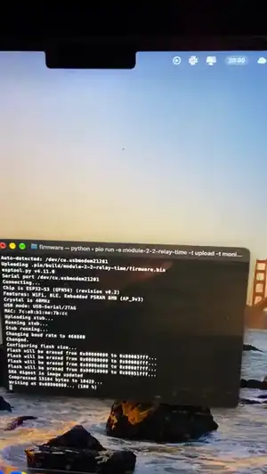

# Модуль 2.2: час спрацювання реле й транзистора

Домашнє завдання курсу Embedded Basic, завдання 1 у редакції викладача: порівняти час транзистора і реле методом опитування.
Плата ESP32-S3-WROOM-1-N16R8, PlatformIO, Arduino. Опційне завдання 2 (програмний ШІМ) не робив.



Анімація — перші 20 с. Відео повністю (24 с): [demo.mp4](demo.mp4)

## Схема

Реле: [map.svg](map.svg). Транзистор окремо: [map-transistor.svg](map-transistor.svg). На макетці стоять ще деталі інших домашок.

```
Реле:
GPIO12 -> 10 кОм -> база BC547B, емітер -> GND
колектор -> IN модуля реле, колектор -> 10 кОм -> +5 В
NO -> GPIO11 (INPUT_PULLUP), COM -> GND

Транзистор окремо:
GPIO10 -> 10 кОм -> база BC547B
колектор -> 3,3 В
емітер -> GPIO3 (INPUT), емітер -> 10 кОм -> GND
```

Реле підключив як сухий контакт (варіант із заняття 22.09), а не NO -> 3,3 В і COM -> pull-down, як у тексті завдання. Контакт той самий, змінюється лише рівень, який читає пін.

## Що робить

| Клавіша | Дія |
|---|---|
| `r` | 20 вимірів реле |
| `t` | 20 вимірів транзистора |

Метод: `start = micros()`, `digitalWrite`, опитування входу до зміни рівня, `end = micros()`. Береться перший фронт, тобто брязкіт у час не входить, а між командами пауза 300 мс.

## Результат

| Серія, по 20 вимірів | Увімкнення | Вимкнення |
|---|---|---|
| транзистор, 1 | 1,1 мкс | 1,0 мкс |
| транзистор, 2 | 2,5 мкс | 1,0 мкс |
| реле + ключ, 1 | 3790,9 мкс | 3668,8 мкс |
| реле + ключ, 2 | 3639,1 мкс | 3870,9 мкс |
| реле + ключ, 3 | 3628,2 мкс | 3891,5 мкс |

Чисте реле (реле мінус транзистор із того самого запуску):

| Серія реле | Увімкнення | Вимкнення |
|---|---|---|
| 2 | 3637,9 мкс | 3869,9 мкс |
| 3 | 3625,8 мкс | 3890,5 мкс |

Висновок: транзистор швидший за реле більш ніж у 1000 разів. Реле спрацьовує приблизно за 3,6–3,9 мс.

## Обмеження

- 1 мкс у транзистора це межа методу (крок `micros()`), а не його реальний час.
- У другій серії транзистора було кілька вимірів по 7–8 мкс, причину не шукав.
- Що в реле довше, увімкнення чи вимкнення, сказати не можу: у серії 1 довше увімкнення, у серіях 2 і 3 вимкнення. Причину різниці не встановив.
- Усередині серій 2 і 3 час плавно змінюється: увімкнення росте, вимкнення падає.
- Час транзистора міряний в іншій схемі, ніж ключ реле. На результат це майже не впливає, бо різниця в тисячі разів.
- Відео знято в окремому запуску, тому числа на ньому трохи інші, ніж у таблиці.

## Запуск

```
pio run -t upload -t monitor
```
